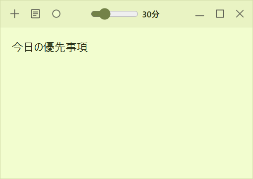

# Floatnote

Windows と Mac のための、定期的に手前へ戻る小さな付箋アプリ。

付箋ごとに周期を設定でき、初期値は **30 分**。手前に戻るときも、作業中のアプリから文字入力を奪いません。



## インストール

[最新版をダウンロード](https://github.com/menma22/floatnote/releases/latest)してインストールします。Node.js などの開発環境は不要です。

- Windows 10/11（x64）: `Floatnote-Setup-*.exe` を実行。
- macOS 13 Ventura 以降: `Floatnote-*-mac-universal.dmg` を開き、Floatnote を Applications へ移動。Apple Silicon・Intel の両方に対応します。

[インストール手順と AI に渡す依頼文](docs/install-v3.md)を用意しています。PC を操作できる AI に、この案内を渡して導入を頼めます。

Windows 版は未署名、Mac 版はアドホック署名で Developer ID 署名・公証はありません。初回の発行元確認や OS の警告には本人の操作が必要になる場合があります。

## 使い方

- 普段はメモだけを表示し、付箋にカーソルを重ねるとヘッダーが現れます。キーボードで操作する際もヘッダーを表示します。
- `＋` で付箋を増やす。一覧ボタンで保存済みの付箋を開く。
- ヘッダーのスライダーで周期を **5〜120 分**の間で調整する。
- 色ボタンで付箋の色を選ぶ。
- `**太字**`、`- 箇条書き`、`1. 番号付きリスト` を入力して Enter で整形する。太字は `Ctrl+B`（Mac は `Command+B`）でも操作できる。
- `×` は付箋を閉じ、その付箋の周期を止める。本文は残り、一覧から開き直せる。
- 最小化した付箋は周期が来ると戻る。すべて閉じても、通知領域のアイコンから一覧を開ける。
- 完全に終了するには、通知領域アイコンのメニューで「終了」を選ぶ。

保存先は Windows の `%APPDATA%/Floatnote/notes.json`、Mac の `~/Library/Application Support/Floatnote/notes.json`。メモは PC 内に保存し、外部へ送信しません。クラウド同期・ログインはありません。OS にログインしたときの自動起動は行いません。

## 開発

Windows 10/11 または macOS 13 以降、Node.js 22.12 以上が必要です。

```powershell
npm ci
npm start
```

```powershell
npm test          # 保存・モデル・周期の単体テスト
npm run test:e2e # 実際の Electron ウィンドウで操作確認
npm run check    # 書式と静的検査
npm run package  # release/ に Windows インストーラーを生成
npm run package:mac # Mac 上で Universal DMG / ZIP を生成
```

Electron の main が保存・ウィンドウ・タイマーを管理し、Tiptap が本文を編集します。検証は一時データを使い、普段の付箋へ影響しません。ロック画面や Windows のセキュアデスクトップなどでは手前への表示を保証できません。

- [現在の要件・設計 v7](docs/spec-v7.md) — Mac の配布・標準操作とホバーヘッダー
- [要件・設計 v6](docs/spec-v6.md) — ヘッダー自動表示と AI 向け導入案内
- [要件・設計 v5](docs/spec-v5.md) — Windows の表示倍率と寸法復元
- [実装照合・検証 v2](docs/verification-v2.md) — 要件とコード、確認結果、CI ビルド条件
- [要件・設計 v4](docs/spec-v4.md) — 小さい初期サイズと淡い黄緑を反映
- [要件・設計 v3](docs/spec-v3.md) — 初期サイズを約半分へ変更
- [要件・設計 v2](docs/spec-v2.md) — 色選択とフォーカス方針
- [当初の要件・設計 v1](docs/spec-v1.md) — 実装前の基準と API 契約

MIT License
